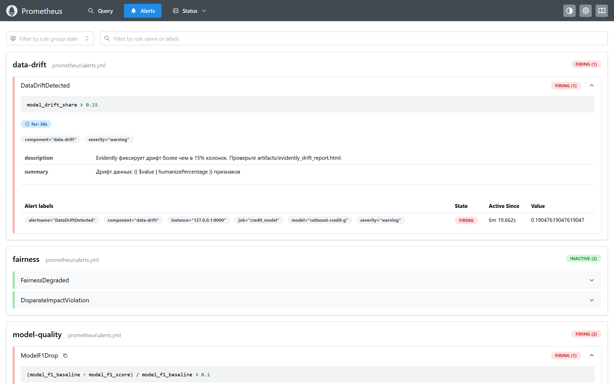
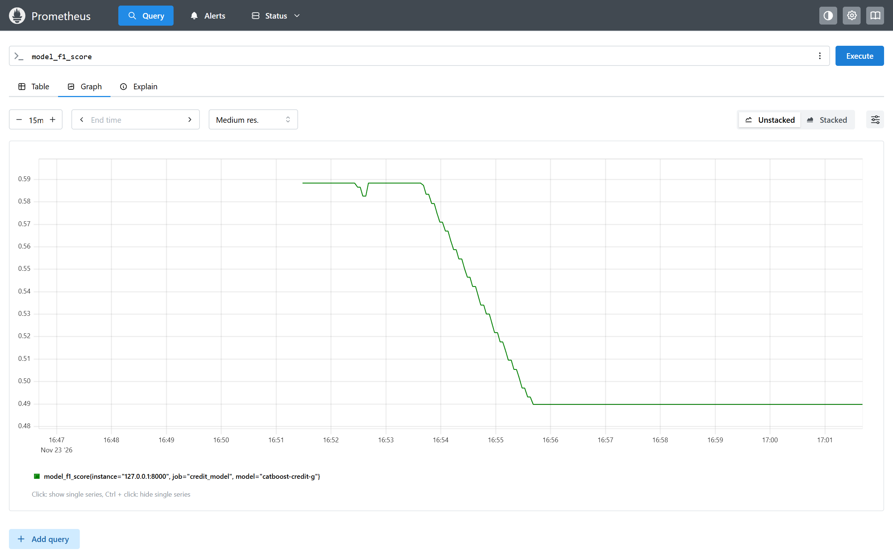
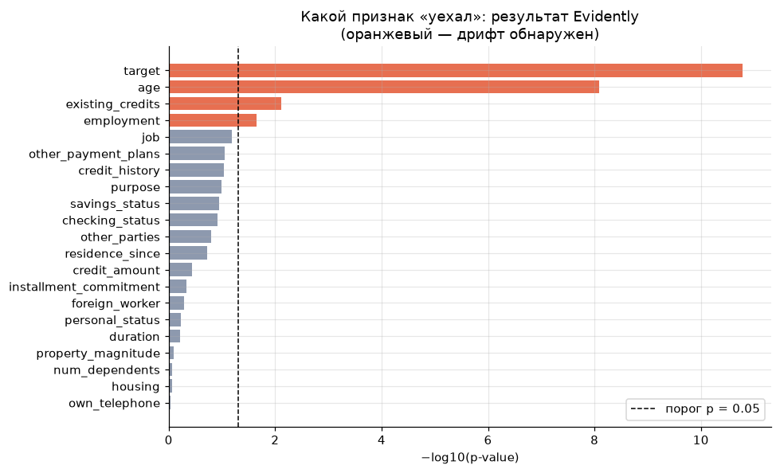
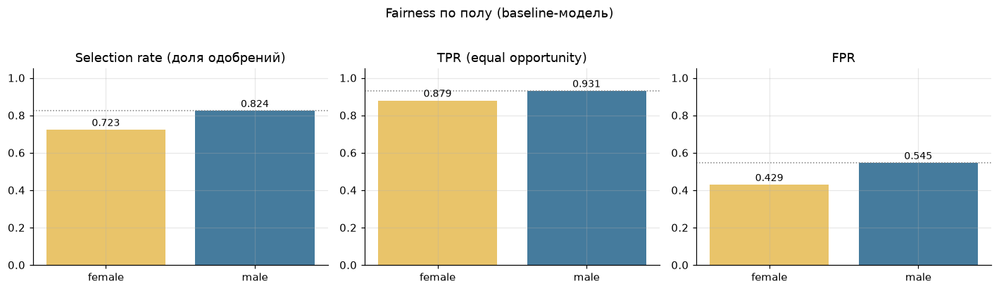

# ДЗ 4. Система мониторинга ML-модели

Домашнее задание по курсу **«Бизнес-применение машинного обучения»**:
полный контур мониторинга кредитного скоринга — от данных и модели
до алертов в Prometheus.

> Датасет: `credit-g` (OpenML id 31) · Модель: CatBoost · Дрифт: Evidently ·
> Метрики: `/metrics` → Prometheus → алерты · Fairness: аудит по полу

---

## Что сделано (по пунктам задания)

| № | Шаг | Результат |
|---|-----|-----------|
| 01 | Датасет | `credit-g`: 1000 клиентов, 20 признаков, кэш в `artifacts/data/credit_g.csv` |
| 02 | Модель | `CatBoostClassifier`, F1 = **0.588**, ROC AUC = **0.796** на отложенной выборке |
| 03 | Дрифт | `age` +5 лет, доля дефолтов 30 % → 7.9 % |
| 04 | Evidently | дрифт в **4 из 21** колонки (19 %), включая `age` и `target`; HTML-отчёт |
| 05 | Fairness | DPD = **0.101**, EOD = **0.052**, DIR = **0.877** (правило 80 % соблюдено) |
| 06 | Prometheus | 5 правил алертов, живой сервер, падение F1 0.588 → 0.490 и горящий `ModelF1Critical` |

### Ключевые метрики

| Метрика | Baseline (test) | После дрифта | Δ |
|---|---|---|---|
| F1 (класс `bad`) | 0.588 | 0.490 | −16.7 % отн. |
| Precision | 0.714 | 0.387 | −0.327 |
| Recall | 0.500 | 0.667 | +0.167 |
| ROC AUC | 0.796 | 0.896 | +0.100 |
| Accuracy | 0.790 | 0.890 | +0.100 |
| Доля класса `bad` | 30.0 % | 7.9 % | −22.1 п.п. |

> Падение F1 при росте accuracy — классическая ловушка дисбаланса:
> модель «угадывает» редкий класс хуже, но общая доля верных ответов растёт.
> Именно поэтому алерт настроен на F1, а не на accuracy.

---

## Структура репозитория

```
Homework_4.ipynb              ← основной ноутбук (исполненный, с выводами)
Homework_4_report.docx        ← отчёт Word: методика, результаты, скриншоты
Homework_4_report.pdf         ← тот же отчёт в PDF (для печати и презентации)
Homework_4_presentation.docx  ← презентация на 13 слайдов (Word, формат 16:9)
Homework_4_presentation.pdf   ← она же в PDF (для показа со слайдами)
README.md                     ← этот файл
requirements.txt              ← зависимости
artifacts/
  data/                       ← credit-g (исходный и дрифтованный), ARFF-кэш
  figures/                    ← графики для отчёта и презентации
  screenshots/                ← скриншоты Prometheus
  evidently_drift_report.html ← интерактивный отчёт Evidently
  metrics.json                ← все метрики в машинночитаемом виде
  model/                      ← обученная модель CatBoost (.cbm)
prometheus/
  prometheus.yml              ← конфиг скрейпинга
  alerts.yml                  ← 5 правил алертов
src/
  metrics_exporter.py         ← экспортёр метрик (/metrics на :8000)
  prototype.py                ← консольный прогон пайплайна (без ноутбука)
tools/                        ← вспомогательные скрипты (загрузка данных, скриншоты)
```

---

## Быстрый старт

Требуется Python 3.12 (проверено на 3.12.14, Windows).

```powershell
# 1. зависимости (локально, без установки в систему)
python -m pip install --target .pylibs -r requirements.txt

# 2. ноутбук
jupyter nbconvert --to notebook --execute --inplace Homework_4.ipynb
```

Ноутбук сам создаст `artifacts/`, обучит модель, посчитает дрифт,
соберёт отчёт Evidently и запишет конфиги Prometheus.

### Запуск мониторинга

```powershell
# экспортёр метрик (терминал 1)
$env:PYTHONPATH = "$PWD\.pylibs"
python src/metrics_exporter.py --mode replay --port 8000

# Prometheus (терминал 2)
.\prometheus\prometheus-3.16.0.windows-amd64\prometheus.exe `
    --config.file=prometheus\prometheus.yml `
    --storage.tsdb.path=prometheus\data `
    --web.listen-address=127.0.0.1:9090
```

Открыть <http://127.0.0.1:9090/alerts> — через 3–4 минуты после старта
`replay`-сценария (стабильная работа → линейная деградация) загораются алерты.

---

## Как устроен мониторинг

```
CatBoost / батч-прогон  →  artifacts/metrics.json
                                ↓
src/metrics_exporter.py  (prometheus_client, :8000/metrics)
                                ↓  scrape каждые 5 секунд
Prometheus (:9090)  →  alerts.yml  →  Alertmanager / UI /alerts
```

Экспортёр отдаёт гейджи:

| Метрика | Смысл |
|---|---|
| `model_f1_score` | текущий F1 по классу `bad` |
| `model_f1_baseline` | F1 на валидации при обучении |
| `model_f1_relative_drop` | относительное падение F1 |
| `model_precision`, `model_recall`, `model_roc_auc` | качество |
| `model_drift_share` | доля дрифтующих колонок (Evidently) |
| `model_fairness_dpd`, `model_fairness_eod`, `model_fairness_dir` | fairness |

### Правила алертов (`prometheus/alerts.yml`)

| Алерт | Условие | Severity |
|---|---|---|
| `ModelF1Drop` | относительное падение F1 > 10 % в течение 1 мин | warning |
| `ModelF1Critical` | `model_f1_score < 0.52` дольше 30 с | critical |
| `DataDriftDetected` | дрифт > 15 % колонок дольше 30 с | warning |
| `FairnessDegraded` | DPD > 0.15 дольше 1 мин | warning |
| `DisparateImpactViolation` | DIR < 0.80 дольше 1 мин | warning |

### Скриншоты живого Prometheus

**Горящие алерты** (`/alerts`):



**Алерт по F1 с выражением и значением** (`/alerts`):


**Падение F1** (`/graph`):



**Рост дрифта** (`/graph`):


**Скрейпинг-таргеты** (`/targets`):


---

## Evidently: что именно «уехало»

Сравниваются обучающая выборка (reference) и дрифтованный поток (current),
`DataDriftPreset` прогоняет по каждой колонке статистический тест
(K-S для числовых, Z-test/χ² для категориальных), порог p-value = 0.05.

Итог: дрифт найден в **4 колонках из 21**, в том числе:

- `age` — сдвиг +5 лет (K-S, p ≈ 0);
- `target` — доля дефолтов 30 % → 7.9 % (Z-test, p ≈ 0).

Полный интерактивный отчёт: [`artifacts/evidently_drift_report.html`](artifacts/evidently_drift_report.html).



---

## Fairness по признаку `sex`

В датасете `credit-g` **нет колонки `sex`** — пол закодирован в `personal_status`
(`male single`, `female div/dep/mar`, …). Признак восстановлен так:

```python
SEX_MAP = {
    "male div/sep": "male", "male single": "male", "male mar/wid": "male",
    "female div/dep/mar": "female",
}
```

Получено 690 мужчин и 310 женщин. Защищённый признак **не подаётся в модель** —
он используется только для аудита.

| Метрика | Значение | Интерпретация |
|---|---|---|
| Selection rate, male | 0.824 | доля одобрений |
| Selection rate, female | 0.723 | доля одобрений |
| DPD | 0.101 | разрыв одобрений ~10 п.п. |
| EOD (TPR gap) | 0.052 | разрыв по «хорошим» клиентам |
| DIR | 0.877 | > 0.8 → правило 80 % соблюдено |



Вывод: формального нарушения правила 80 % нет, но разрыв в 10 п.п. заметен
и должен отслеживаться алертом `FairnessDegraded` при росте DPD > 0.15.
После дрифта разрыв слегка сократился (DPD 0.082), но модель стала одобрять
заметно больше заявок в целом — это уже бизнес-риск, а не только ML-метрика.

---

## Ограничения и что улучшить

- **Дрифт синтетический**: `age +5` и down-sampling класса `bad`. В проде
  дрифт приходит из реального потока заявок и требует адаптивных порогов.
- **F1 считается при наличии меток** (с задержкой на созревание). В реальном
  контуре нужен ещё прокси-мониторинг без меток (PSI, доля отказов, входной поток).
- **Нет Alertmanager**: алерты видны в UI Prometheus, но не отправляются
  в почту/Telegram. Для продакшена нужен Alertmanager + маршрутизация.
- **Fairness только по полу**: стоит добавить возраст и `foreign_worker`,
  а также проверить equalized odds и калибровку по группам.
- **Порог 0.5 фиксирован**: в реальном скоринге порог выбирается по бизнес-стоимости
  ошибок (FN дороже FP) и должен быть частью мониторинга.

---

## Сценарий демонстрации (для записи / защиты)

0. **Презентация** — открыть `Homework_4_presentation.docx` (или PDF): 13 слайдов
   на 16:9, по одному тезису на слайд, все скриншоты уже внутри.
1. **Ноутбук** — открыть `Homework_4.ipynb`, прокрутить сверху вниз: данные →
   модель (F1 0.588) → дрифт → отчёт Evidently → fairness. Все выводы уже внутри,
   ничего запускать не нужно.
2. **Отчёт Evidently** — открыть `artifacts/evidently_drift_report.html` в браузере,
   показать таблицу дрифта и `age`.
3. **Живой Prometheus** — открыть <http://127.0.0.1:9090/alerts>: `ModelF1Drop`,
   `ModelF1Critical` и `DataDriftDetected` в состоянии FIRING; на `/graph`
   показать кривую падения `model_f1_score` с 0.588 до 0.490.
4. **Вывод на слайд** — «мониторинг = ранний контур (дрифт без меток) + поздний
   контур (качество с метками) + аудит справедливости».

> Если Prometheus уже остановлен — запустить по инструкции выше и подождать
> 3–4 минуты: экспортёр воспроизводит сценарий деградации заново.

---

## Автор

Домашняя работа №4, курс «Бизнес-применение машинного обучения».
