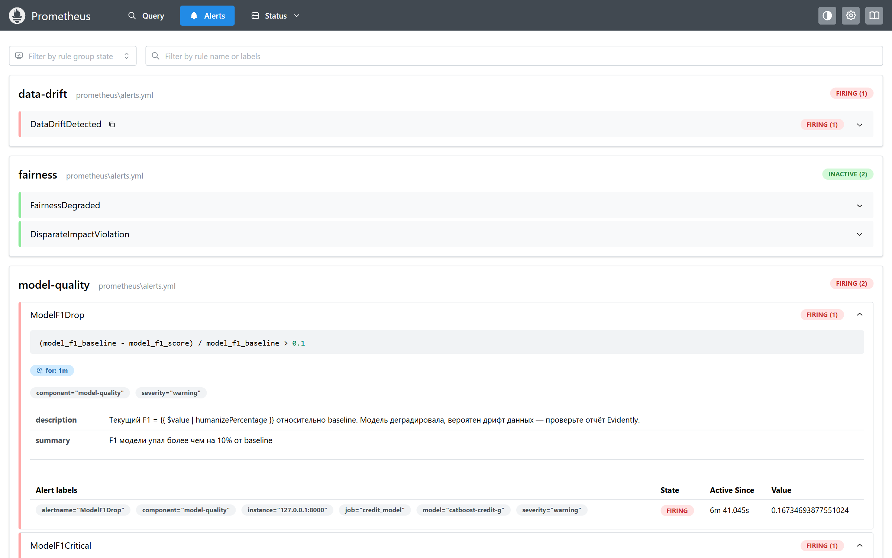
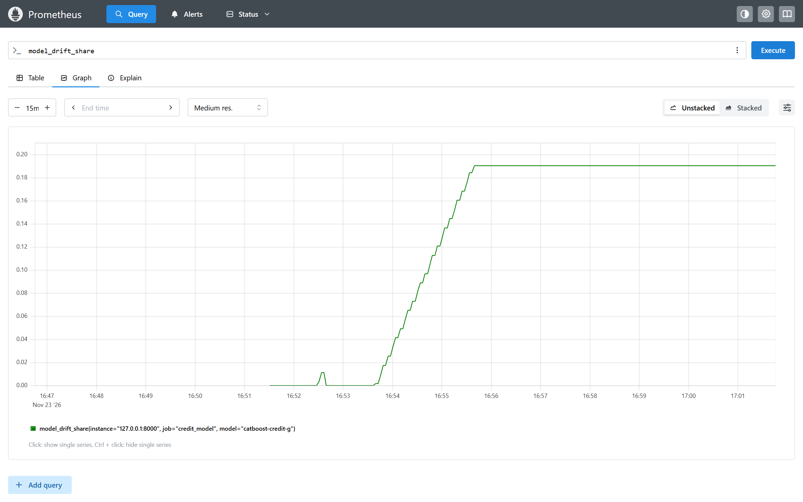
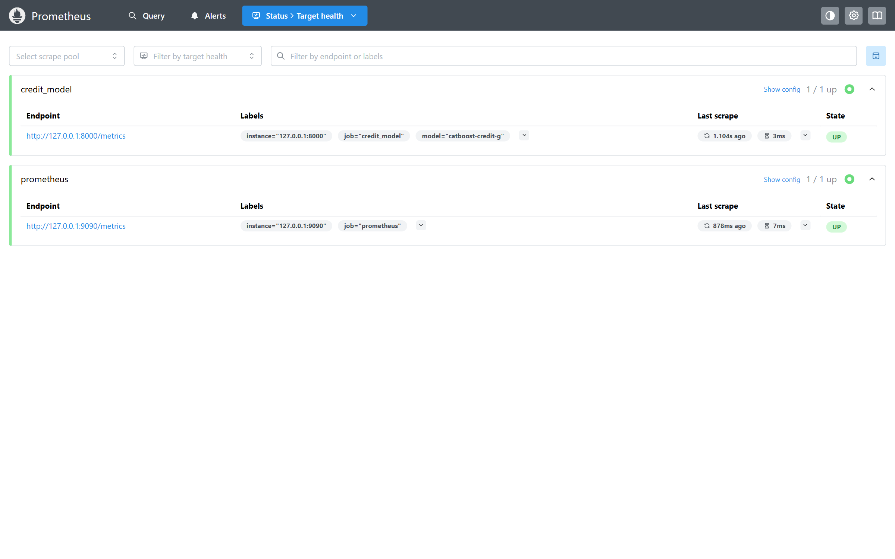

# Задание 4. Система мониторинга ML-модели

## Задание и результат

| № | Шаг задания | Что сделано |
|---|---|---|
| 01 | Взять датасет `credit-g` | 1000 клиентов, 20 признаков, кэш в `artifacts/data/credit_g.csv` |
| 02 | Обучить модель (CatBoost) | F1 = **0.588**, ROC AUC = **0.796** на отложенной выборке (n = 300) |
| 03 | Сымитировать дрифт | `age` +5 лет, доля дефолтов 30 % → 7.9 % |
| 04 | Запустить Evidently | дрифт в **4 из 21** колонки (19 %), включая `age` и `target`; HTML-отчёт |
| 05 | Посчитать fairness по `sex` | DPD = **0.101**, EOD = **0.052**, DIR = **0.877** |
| 06 | Экспортировать F1 в Prometheus | 5 правил, живой сервер, вживую сработали 3 алерта |

### Ключевые метрики

| Метрика | Baseline (test, n = 300) | После дрифта (n = 228) | Δ |
|---|---|---|---|
| F1 (класс `bad`) | 0.588 | 0.490 | −16.7 % отн. |
| Precision | 0.714 | 0.387 | −0.327 |
| Recall | 0.500 | 0.667 | +0.167 |
| ROC AUC | 0.796 | 0.896 | +0.100 |
| Accuracy | 0.790 | 0.890 | +0.100 |
| Доля класса `bad` | 30.0 % | 7.9 % | −22.1 п.п. |

> Падение F1 при росте accuracy — классическая ловушка дисбаланса: модель хуже
> ловит редкий класс, но общая доля верных ответов растёт. Поэтому алерт настроен
> на F1, а не на accuracy.

---

## Структура репозитория

```
Homework_4.ipynb              ← исполненный ноутбук (весь пайплайн)
README.md                     ← этот файл
requirements.txt              ← зависимости с версиями
.gitignore                    ← .pylibs, бинарники Prometheus, TSDB, кеши

artifacts/
  data/                       ← credit-g (ARFF-кэш, исходный и дрифтованный CSV)
  figures/                    ← 6 графиков для отчёта и презентации
  screenshots/                ← 5 скриншотов Prometheus + prometheus_state.json
  model/                      ← обученная модель catboost_credit_g.cbm
  evidently_drift_report.html ← интерактивный отчёт Evidently (4.2 МБ)
  evidently_drift_snapshot.json
  metrics.json                ← все метрики в машинночитаемом виде

prometheus/
  prometheus.yml              ← конфиг скрейпинга (:8000 → :9090)
  alerts.yml                  ← 5 правил алертов
  VERSION.txt                 ← версия скачанного Prometheus

src/
  metrics_exporter.py         ← экспортёр метрик (/metrics на :8000)
  prototype.py                ← тот же пайплайн без ноутбука (CLI)

tools/
  make_notebook.py            ← генератор Homework_4.ipynb
  make_report.py              ← сборка отчёта (9 страниц)
  make_presentation.py        ← сборка презентации (13 слайдов)
  start_demo.ps1              ← поднять всё для показа одной командой
  stop_demo.ps1               ← погасить экспортёр и Prometheus
  prometheus_screens.py       ← скриншоты UI через Playwright + Edge
  screenshots.py              ← то же через headless Edge (без Playwright)
  fetch_data.py               ← загрузка credit-g
  fetch_prometheus.py         ← загрузка Prometheus для Windows
  pipx.py                     ← обёртка pip (обход проблемы с временными каталогами)
```

Бинарники Prometheus (`prometheus/prometheus-*/`) и локальные библиотеки
(`.pylibs/`) в репозиторий не входят — они восстанавливаются по инструкции ниже.

---

## Быстрый старт

Проверено на Python 3.12.14 (Windows). Библиотеки ставятся локально в `.pylibs`,
системный Python не затрагивается — ноутбук сам добавляет эту папку в `sys.path`.

```powershell
# 1. зависимости
python -m pip install --target .pylibs -r requirements.txt

# 2. прогон ноутбука (создаст artifacts/, обучит модель, соберёт отчёт Evidently)
python -m nbconvert --to notebook --execute --inplace Homework_4.ipynb

# 3. (опционально) пересборка документов из готовых артефактов
python tools/make_report.py
python tools/make_presentation.py
```

Пайплайн детерминирован: `random_state = 42`, стратифицированное разбиение 70/30,
датасет кэшируется в `artifacts/data/credit_g.csv`, поэтому повторный прогон
даёт те же цифры и не требует сети.

### Запуск мониторинга

```powershell
# терминал 1 — экспортёр метрик
$env:PYTHONPATH = "$PWD\.pylibs"
python src/metrics_exporter.py --mode replay --port 8000

# терминал 2 — Prometheus
.\prometheus\prometheus-3.16.0.windows-amd64\prometheus.exe `
    --config.file=prometheus\prometheus.yml `
    --storage.tsdb.path=prometheus\data `
    --web.listen-address=127.0.0.1:9090
```

Открыть <http://127.0.0.1:9090/alerts>: через 3–4 минуты работы `replay`-сценария
(60 с стабильной работы → линейная деградация до измеренного уровня) загораются
`ModelF1Drop`, `ModelF1Critical` и `DataDriftDetected`.

Проверить конфиг без запуска:

```powershell
.\prometheus\prometheus-3.16.0.windows-amd64\promtool.exe check config prometheus\prometheus.yml
```

---

## Как устроен мониторинг

```
CatBoost / батч-прогон  →  artifacts/metrics.json
                                ↓
src/metrics_exporter.py  (prometheus_client, :8000/metrics)
                                ↓  scrape каждые 5 секунд
Prometheus (:9090)  →  alerts.yml  →  состояние FIRING в UI
```

Два контура контроля:

- **ранний** — Evidently ловит дрифт по входным данным, метки не нужны;
- **поздний** — F1 и другие метрики качества появляются после разметки, зато точны.

### Гейджи экспортёра

| Метрика | Смысл |
|---|---|
| `model_f1_score` | текущий F1 по классу `bad` |
| `model_f1_baseline` | F1 на валидации при обучении |
| `model_f1_relative_drop` | относительное падение F1 |
| `model_precision`, `model_recall`, `model_roc_auc` | качество модели |
| `model_positive_rate` | доля дефолтов в потоке |
| `model_drift_share` | доля дрифтующих колонок по Evidently |
| `model_fairness_dpd`, `model_fairness_eod`, `model_fairness_dir` | fairness по полу |

### Правила алертов (`prometheus/alerts.yml`)

| Алерт | Условие | Severity |
|---|---|---|
| `ModelF1Drop` | относительное падение F1 > 10 % в течение 1 мин | warning |
| `ModelF1Critical` | `model_f1_score < 0.52` дольше 30 с | critical |
| `DataDriftDetected` | дрифт > 15 % колонок дольше 30 с | warning |
| `FairnessDegraded` | DPD > 0.15 дольше 1 мин | warning |
| `DisparateImpactViolation` | DIR < 0.80 дольше 1 мин | warning |

---

## Скриншоты живого Prometheus

Сняты с работающего сервера во время `replay`-сценария (полный набор — в
[`artifacts/screenshots/`](artifacts/screenshots/)).

**Горящие алерты** (`/alerts`, свёрнутый вид — видно все три группы):


**Алерт по F1 раскрыт: выражение, аннотации, состояние FIRING, значение 0.167:**



**Падение F1: плато 0.588 → деградация → 0.490** (`/graph`):


**Рост дрифта: `model_drift_share` 0 → 0.190** (`/graph`):



**Скрейпинг-таргеты: оба в состоянии UP** (`/targets`):



---

## Evidently: что именно «уехало»

Сравниваются обучающая выборка (reference) и дрифтованный поток (current).
`DataDriftPreset` прогоняет по каждой колонке статистический тест
(K-S для числовых, Z-test / χ² для категориальных), порог p-value = 0.05.

Итог — дрифт в **4 колонках из 21** (drift share = 19 %):

| Колонка | p-value | Дрифт |
|---|---|---|
| `target` | 1.65e-11 | да |
| `age` | 8.25e-09 | да |
| `existing_credits` | 7.61e-03 | да |
| `employment` | 2.22e-02 | да |

Полный интерактивный отчёт:
[`artifacts/evidently_drift_report.html`](artifacts/evidently_drift_report.html).


---

## Fairness по признаку `sex`

В датасете `credit-g` **нет колонки `sex`** — пол закодирован в `personal_status`.
Признак восстановлен так:

```python
SEX_MAP = {
    "male div/sep": "male", "male single": "male", "male mar/wid": "male",
    "female div/dep/mar": "female",
}
```

Получено 690 мужчин и 310 женщин. Защищённый признак **не подаётся в модель** —
он используется только для аудита.

| Группа | N | Selection rate | TPR | FPR |
|---|---|---|---|---|
| female | 101 | 0.723 | 0.879 | 0.429 |
| male | 199 | 0.824 | 0.931 | 0.545 |

| Метрика | Значение | Интерпретация |
|---|---|---|
| DPD (demographic parity difference) | 0.101 | разрыв долей одобрений ≈ 10 п.п. |
| EOD (equal opportunity difference) | 0.052 | разрыв TPR между группами |
| Equalized odds (FPR gap) | 0.117 | разница ложноположительных одобрений |
| DIR (disparate impact ratio) | 0.877 | > 0.80 → правило 80 % соблюдено |


Вывод: формального нарушения правила 80 % нет, но разрыв в 10 п.п. заметен и
должен отслеживаться алертом `FairnessDegraded` при росте DPD > 0.15.
После дрифта разрыв слегка сократился (DPD 0.082), но модель стала одобрять
заметно больше заявок в целом — это уже бизнес-риск, а не только ML-метрика.

---

## Ограничения и что улучшить

- **Дрифт синтетический**: `age +5` и down-sampling класса `bad`. В продакшене
  дрифт приходит из реального потока заявок и требует адаптивных порогов.
- **F1 считается при наличии меток** (с задержкой на созревание). Нужен ещё
  прокси-мониторинг без меток: PSI, доля отказов, объём входного потока.
- **Нет Alertmanager**: алерты видны в UI Prometheus, но не уходят в почту/Telegram.
  Для продакшена нужен Alertmanager с маршрутизацией и дедупликацией.
- **Fairness только по полу**: стоит добавить возраст и `foreign_worker`,
  проверить equalized odds и калибровку по группам.
- **Порог 0.5 фиксирован**: в реальном скоринге он выбирается по бизнес-стоимости
  ошибок (FN дороже FP) и тоже должен быть частью мониторинга.
- **Датасет маленький** (1000 строк): метрики шумные, доверительные интервалы
  широкие — для продакшена нужен больший объём и bootstrap-оценки.
